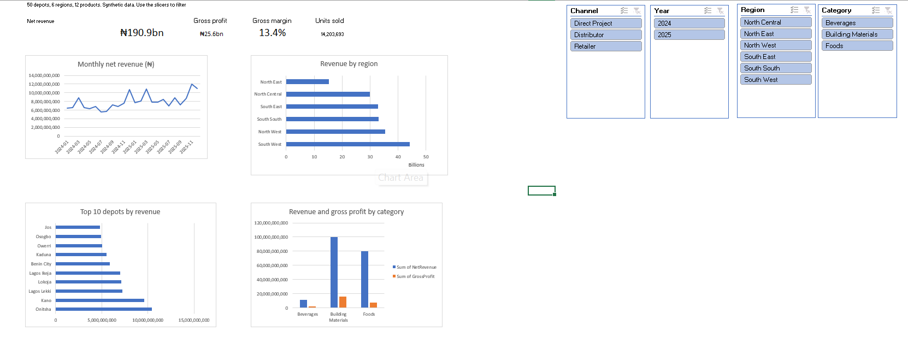
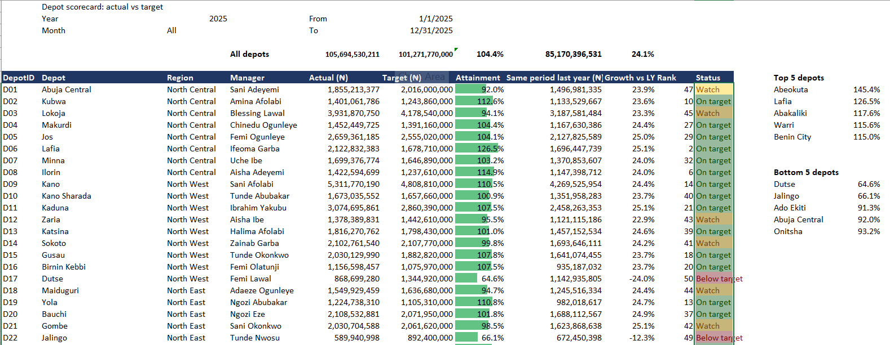

# Depot Sales Performance Dashboard (Excel)

An interactive Excel dashboard for a fictional Nigerian building-materials and FMCG distributor with **50 depots in 6 regions**, built from **62,700 rows of messy weekly sales data (2024–2025)**.



## Key findings
- **₦190.9bn net revenue** and **₦25.6bn gross profit** over two years (**13.4% gross margin**).
- Revenue grew **24% in 2025** (₦85.2bn → ₦105.7bn).
- **South West** is the biggest region (₦44.2bn); **North East** the smallest (₦15.3bn).
- **Onitsha** and **Kano** are the top depots (₦10.4bn and ₦9.6bn).
- **Building Materials** brings about half of all revenue; Beverages is small.
- Clear seasonal peaks in **March and December** each year.
- In 2025 the network reached **104.4% of target**: 40 depots on target, 8 to watch and 2 below. **Abeokuta** led (145.4%); **Dutse** (64.6%) and **Jalingo** (66.1%) need attention.

## What I did
1. **Cleaned the data in Power Query.** Removed 300 duplicate rows, fixed mixed date formats (yyyy-mm-dd and dd/mm/yyyy), standardised depot codes and channel names, and filled blank discounts. Result: 62,400 clean rows.
2. **Calculated measures.** Net revenue, gross profit and month, and merged depot and product details.
3. **Built 5 PivotTables** (KPIs, monthly trend, region, top 10 depots, category).
4. **Designed the dashboard.** KPI cards using `GETPIVOTDATA`, 4 PivotCharts, and **slicers** for Year, Region, Category and Channel that filter everything at once.
5. **Built a depot scorecard (actual vs target).** Pick a year and month from drop-downs and every depot's actual revenue, target, attainment, growth vs the same period last year, rank and status update automatically. It uses `XLOOKUP`, `SUMIFS`, `EDATE`/`EOMONTH` and dynamic array formulas (`SORTBY`, `SORT`, `SEQUENCE`), with data bars and colour-coded status.



## Tools
Microsoft Excel: Power Query, PivotTables, PivotCharts, Slicers, GETPIVOTDATA, XLOOKUP, SUMIFS, dynamic arrays, data validation, conditional formatting, custom number formats (₦ billions).

## Files
```
data/raw/        raw CSVs (sales, depots, products, monthly targets)
dashboard/       depot_sales_dashboard.xlsx
docs/            data_dictionary.md
images/          dashboard and scorecard screenshots
scripts/         generate_data.py (creates the synthetic data)
```

## About the data
All data is **synthetic**, generated with `scripts/generate_data.py` (seed 2026). The company, depots, managers and figures are fictional. The messy parts (duplicates, mixed dates, inconsistent text) were added on purpose to show real-world cleaning.

## Contact
Philip Nuhu · [LinkedIn](https://www.linkedin.com/in/philip-nuhu-data-analyst) · nuhuphilip61@gmail.com
